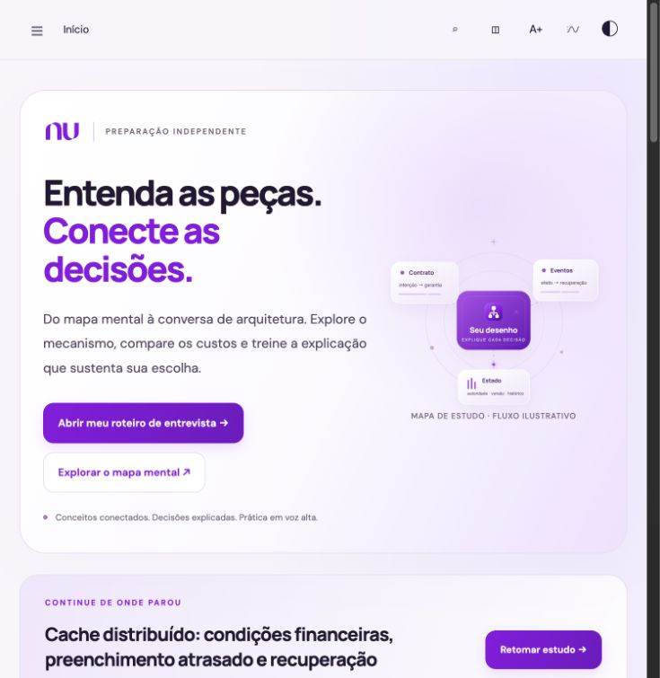

# nuArch — Architecture Lab

Portal independente, em português, para estudar e praticar decisões de system design no domínio financeiro. Combina mocks escritos, diagramas progressivos, experimentos interativos e referências rastreáveis em uma aplicação estática.

**[Abrir o portal](https://wesleyvieira99.github.io/nuArch/)** · [Case study](docs/CASE_STUDY.md) · [Arquitetura do projeto](docs/ARCHITECTURE.md) · [Validação](docs/VALIDATION.md)

O projeto começou como preparação para uma entrevista de arquitetura e evoluiu para um laboratório de estudo. A proposta é tornar explícitos requisitos, invariantes, alternativas, falhas e limites de cada decisão — inclusive os limites dos próprios exemplos.



## Índice

- [Como revisar este projeto](#como-revisar-este-projeto)
- [O que experimentar](#o-que-experimentar)
- [Executar localmente](#executar-localmente)
- [Comandos](#comandos)
- [Estrutura](#estrutura)
- [Escopo e transparência](#escopo-e-transparência)

## Como revisar este projeto

| Tempo          | Percurso sugerido                                                                                                                                                | O que observar                                                                                                      |
| -------------- | ---------------------------------------------------------------------------------------------------------------------------------------------------------------- | ------------------------------------------------------------------------------------------------------------------- |
| **5 minutos**  | Leia o [case study](docs/CASE_STUDY.md) e abra o [roteiro de uma entrevista](https://wesleyvieira99.github.io/nuArch/#playbook).                                 | Problema, público, experiência entregue e limites do projeto.                                                       |
| **15 minutos** | Continue pela [arquitetura](docs/ARCHITECTURE.md), explore um diagrama e altere um experimento.                                                                  | Separação entre conteúdo, interface e modelos; decisões de persistência, acessibilidade e entrega estática.         |
| **30 minutos** | Execute `npm run check`, consulte a [validação registrada](docs/VALIDATION.md) e examine os [testes](tests/) e o [ledger executável](examples/ledger/README.md). | Invariantes verificadas, falhas cobertas, limites dos testes e diferença entre modelo didático e sistema produtivo. |

## O que experimentar

- **Conduzir uma conversa:** 13 cenários, cada um com dez etapas de uma entrevista de 60 minutos. Falas, perguntas, desenho incremental e aprofundamentos ajudam a adaptar a resposta ao enunciado.
- **Comparar decisões:** 64 padrões com alternativas, mecanismos, operação e implementações possíveis em AWS, Azure e infraestrutura própria.
- **Investigar mecanismos:** seis capítulos de fundamentos, mapa com 130 conceitos e laboratórios sobre idempotência, filas, latência, particionamento e ledger.
- **Praticar e registrar:** 1.200 perguntas comentadas, 120 simulados, 50 vídeos públicos, notas, favoritos e progresso no navegador.

Essas contagens descrevem o escopo dos dados em **01/11/2026**, não uma medida de qualidade ou uma cobertura universal. O [guia de conteúdo](docs/CONTENT_GUIDE.md) explica a metodologia, as fontes, os acervos adicionais e como manter os vínculos entre eles.

## Executar localmente

Requisitos: **Node.js 22+**, **npm** e **Python 3.10+**. O portal não requer backend, credenciais ou banco de dados. As dependências npm são ferramentas de desenvolvimento; não há framework de runtime para instalar no navegador.

```sh
git clone https://github.com/wesleyvieira99/nuArch.git
cd nuArch
npm ci
npm run serve
```

Abra [localhost:8080](http://localhost:8080). A versão de desenvolvimento carrega JSON e módulos por HTTP; abrir `index.html` via `file://` não é suportado. Para um arquivo autônomo, use a exportação abaixo.

## Comandos

| Comando                | Finalidade                                                                                            |
| ---------------------- | ----------------------------------------------------------------------------------------------------- |
| `npm run serve`        | Servir o projeto localmente na porta 8080.                                                            |
| `npm run check`        | Executar verificações de sintaxe, testes, validação de conteúdo e verificação da exportação portátil. |
| `npm run test`         | Executar os testes JavaScript.                                                                        |
| `npm run test:ledger`  | Executar os testes Python do ledger, após instalar suas dependências.                                 |
| `npm run format:check` | Conferir a formatação com Prettier.                                                                   |
| `npm run export`       | Gerar `dist/nuArch.html`, com conteúdo e ativos locais incorporados.                                  |

Para o exemplo de ledger, em um shell POSIX:

```sh
python3 -m venv examples/ledger/.venv
. examples/ledger/.venv/bin/activate
python -m pip install -r examples/ledger/requirements.txt
npm run test:ledger
```

O [README do exemplo](examples/ledger/README.md) descreve a API, as invariantes e os limites de concorrência e durabilidade. Após mudar seus arquivos, `python3 scripts/embed_ledger.py` atualiza a cópia exibida no portal.

A exportação inclui os textos, experimentos e imagens do mapa. Referências, vídeos e apresentações continuam externos e exigem conexão. O arquivo é grande por incorporar o acervo visual. Resultados e limitações da verificação ficam em [VALIDATION.md](docs/VALIDATION.md); não se deve inferir garantia de produção a partir de um comando que passou.

## Estrutura

```text
index.html                         Entrada do portal
src/
  app.js                           Composição, navegação e integração
  core/content-loader.mjs          Contrato de carga HTTP e do HTML portátil
  core/progress-store.mjs           Persistência e mesclagem do progresso local
  domain/simulation-models.mjs      Modelos dos experimentos didáticos
  features/
    playbook/playbook.mjs           Experiência do roteiro de entrevista
    playbook/diagram-routing.mjs    Roteamento das arestas dos diagramas
    mindmap/mindmap.mjs             Navegação e consulta do mapa mental
  ui/studio.mjs                     Interações visuais e controle de movimento
styles/                            base.css, mindmap.css, playbook.css, studio.css
data/                              Conteúdo, modelos editoriais e referências JSON
assets/                            Ícones, marca e imagens locais
tests/                             Testes JavaScript (*.test.mjs)
scripts/                           Validação, exportação e manutenção do conteúdo
examples/ledger/                   Exemplo Python em memória e seus testes
docs/                              Case study, arquitetura, validação e conteúdo
```

O [documento de arquitetura](docs/ARCHITECTURE.md) detalha as responsabilidades e os contratos. O [guia de conteúdo](docs/CONTENT_GUIDE.md) orienta alterações nos dados e na proveniência.

## Escopo e transparência

O desenvolvimento teve assistência de IA em pesquisa, curadoria, implementação e revisão. O material não é apresentado como autoria exclusivamente humana nem como auditoria independente. Afirmações técnicas recebem fontes e ressalvas; exemplos e hipóteses de treino são identificados. Veja o [processo editorial](docs/CONTENT_GUIDE.md#processo-editorial-e-assistência-de-ia).

Este é um projeto educacional independente, sem vínculo, patrocínio ou endosso do Nubank. Perguntas e desenhos não revelam enunciados garantidos ou arquitetura interna completa; os modelos não são benchmarks e o ledger não é um serviço financeiro de produção. Não há promessa de aprovação em entrevistas.

Notas e progresso ficam em `localStorage`, com importação e exportação locais, sem sincronização automática entre dispositivos. Vídeos e slides são carregados por provedores externos. Detalhes sobre privacidade, fontes, marcas e limitações estão no [guia de conteúdo](docs/CONTENT_GUIDE.md).
