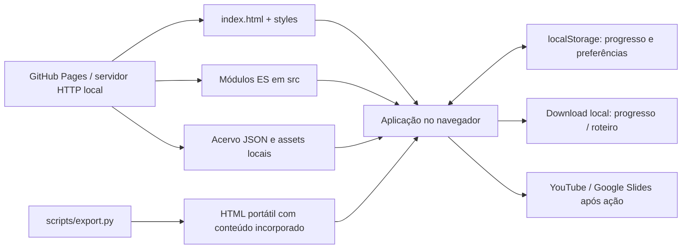

# Arquitetura do nuArch

O nuArch é uma aplicação estática de estudo, executada no navegador e publicada no GitHub Pages. HTML, CSS,
módulos JavaScript e arquivos JSON formam o produto. Não há API própria, servidor de aplicação, autenticação,
banco remoto ou pipeline de eventos em execução.

As arquiteturas financeiras, os serviços de nuvem e tecnologias como Kafka, Redis e Datomic aparecem no
**conteúdo estudado**. Não são dependências operacionais do portal. O exemplo Python de ledger é um exercício
executável separado e não processa transações do site.

Para uma leitura orientada ao problema e às decisões, consulte o [estudo de caso](CASE_STUDY.md). Os comandos
de execução, validação e exportação ficam no [README](../README.md).

## Visão de execução

O diagrama representa responsabilidades, não processos isolados: aplicação, modelos e renderizadores
executam no mesmo contexto JavaScript. Fontes tipográficas, miniaturas e links externos podem exigir rede;
o carregamento dos players e das apresentações é uma ação explícita do usuário.

## Organização do código

| Caminho                                                                                     | Responsabilidade                                                                                   | Limite                                                         |
| ------------------------------------------------------------------------------------------- | -------------------------------------------------------------------------------------------------- | -------------------------------------------------------------- |
| [`index.html`](../index.html)                                                               | Estrutura persistente: menu, cabeçalho, conteúdo principal, busca e notificações                   | Não contém o acervo completo                                   |
| [`src/app.js`](../src/app.js)                                                               | Composição das dependências, carregamento, roteamento, estado de interface e renderizadores gerais | Ainda reúne várias páginas; não é apenas um roteador fino      |
| [`src/core/content-loader.mjs`](../src/core/content-loader.mjs)                             | Ordem canônica das coleções e escolha entre dados HTTP e dados incorporados                        | Compartilha o contrato de carga com a exportação               |
| [`src/features/playbook/`](../src/features/playbook/)                                       | Roteiro adaptável, ensaio, consultas, notas e desenho progressivo                                  | Depende de callbacks para persistência e referências           |
| [`src/features/playbook/diagram-routing.mjs`](../src/features/playbook/diagram-routing.mjs) | Geometria das conexões entre caixas do roteiro                                                     | Trabalha com posições e obstáculos, não com regras financeiras |
| [`src/features/mindmap/mindmap.mjs`](../src/features/mindmap/mindmap.mjs)                   | Mapa, câmera, seleção, inspector, galeria e tela ampliada                                          | Recebe o catálogo e serviços de progresso por injeção          |
| [`src/core/progress-store.mjs`](../src/core/progress-store.mjs)                             | Normalização, merge e fronteira de armazenamento do progresso                                      | Não depende de DOM; o adapter de storage é injetado            |
| [`src/domain/simulation-models.mjs`](../src/domain/simulation-models.mjs)                   | Cálculos puros de quorum, fila, cache, pool e token bucket                                         | Modelos didáticos, não emulação de produtos                    |
| [`src/ui/studio.mjs`](../src/ui/studio.mjs)                                                 | Movimento, player contextual, pausa e tratamento de preferência de movimento reduzido              | Não altera contratos de estudo ou dados editoriais             |
| [`styles/`](../styles/)                                                                     | Base, mapa, roteiro e refinamento visual                                                           | A ordem das folhas faz parte da cascata                        |
| [`data/`](../data/) e [`assets/`](../assets/)                                               | Conteúdo, referências, imagens e procedência de marcas                                             | Dados públicos versionados junto do código                     |
| [`tests/`](../tests/) e [`scripts/`](../scripts/)                                           | Testes de comportamento, validação estrutural, sincronização do exemplo e exportação               | Não substituem revisão editorial ou teste de navegador         |
| [`examples/ledger/`](../examples/ledger/)                                                   | Exercício Python em memória, documentação e testes próprios                                        | Não é backend do portal nem implementação de Datomic           |

A separação torna modelos e fronteiras de estado testáveis sem navegador. Não constitui uma implementação
completa de arquitetura hexagonal: parte da composição, renderização e interação continua em `src/app.js`.

## Carregamento e navegação

1. O navegador carrega o shell e o módulo de entrada. O progresso é lido por um adapter de `localStorage`.
2. O content loader usa a lista canônica `CONTENT_COLLECTIONS`. Na publicação HTTP, busca os onze conjuntos
   JSON em paralelo; no HTML portátil, lê `window.__NUARCH_DATA__`. Uma falha impede a montagem do acervo e
   apresenta uma mensagem de recuperação; não há carga parcial independente por seção.
3. A aplicação monta um registro de fontes por ID e uma lista de consulta deduplicada por URL. Logos são
   associados às tecnologias por identificadores e nomes conhecidos.
4. O fragmento da URL seleciona a página, a entidade e os parâmetros reconhecidos. Por exemplo,
   `#playbook/pix?step=4&view=walk` representa um caso, uma etapa e uma visualização.
5. O renderizador produz o conteúdo e associa os eventos. Em atualizações locais, preserva rolagem e foco
   quando o controle correspondente continua disponível.

Rotas por fragmento funcionam no GitHub Pages sem regras de rewrite. O custo é dividir estado entre a URL,
closures dos módulos e persistência local. Nem todo filtro ou estado transitório é serializado na URL.
Dentro do roteiro, `history.replaceState` mantém o endereço representativo sem criar uma entrada no histórico
para cada clique. Consequentemente, o botão Voltar não percorre cada etapa já visitada.

### Ciclo de vida das features

Mapa e roteiro expõem `html`, `bind` e `destroy`. Antes de substituir a página, a composição chama `destroy`:
o roteiro cancela listeners e seu intervalo; o mapa desconecta listeners e observadores, restaura o estado
de tela ampliada e libera referências de interação. Os eventos do conteúdo dessas features são delegados
ao elemento raiz, com `AbortController` para desmontagem.

A camada visual é instalada uma vez para o documento. Ela observa conteúdo inserido, descarta SVGs removidos
de seu registro, pausa fluxos fora de tela e respeita a preferência do sistema e a pausa escolhida pelo usuário.
O player contextual é criado por clique, sem autoplay. Fechar seu tópico remove a iframe; abrir outro player
contextual fecha o anterior. Essas regras evitam manter áudio escondido em detalhes recolhidos.

## Contratos de conteúdo e referências

Os JSONs são a fonte editorial versionada, não respostas de uma API. Não existe CMS ou ingestão automática em
produção. Os renderizadores esperam contratos específicos de cada catálogo; a validação ocorre antes da
publicação com [`scripts/validate.py`](../scripts/validate.py).

Os contratos centrais são:

- **Identidade estável:** entidades usam `id`; rotas, favoritos, notas e conexões apontam para esses valores.
  Renomear um ID exige revisar essas relações e considerar o progresso já exportado por usuários. Ainda não
  existe um mecanismo geral de migração de IDs editoriais.
- **Referências resolvíveis:** `sourceIds` e `sourceId` devem existir no registro. Uma fonte tem identificação,
  título, tipo e resumo; URL e data dependem da origem. Material fornecido pode ter URL nula, sem publicar
  o documento original. Repetir um ID com outra URL é rejeitado pelo validador.
- **Evidência delimitada:** casos distinguem publicação oficial adaptada, relato público e cenário plausível.
  O campo de limites impede que uma adaptação pedagógica seja apresentada como topologia interna atual ou
  enunciado confirmado de entrevista.
- **Grafo íntegro:** arestas referenciam nós existentes. No roteiro, `firstStep` controla a entrada de uma peça;
  `lastStep` permite retirar uma ligação substituída. Nenhuma aresta deve aparecer antes de seus extremos.
- **Rastreabilidade do mapa:** `originCellIds`, metadados de materiais e vínculos com conceitos mantêm a relação
  entre curadoria, OCR e recortes. OCR auxilia a busca; não é tratado como prova de exatidão técnica.

A validação confere referências, contagens, cronogramas, cobertura de conceitos, assets e parte dos formatos.
Ela não prova que um artigo está atualizado, que uma recomendação é correta ou que um link externo continuará
disponível. Essas verificações exigem revisão das fontes e contexto temporal.

## Progresso, concorrência e importação

O schema de progresso tem quatro conjuntos representados por arrays — `known`, `bookmarks`, `read`, `checks` —
e dois mapas por chave: `notes` e `scores`. A exportação JSON acrescenta versão e data; o arquivo portátil do
portal é outro artefato e não incorpora automaticamente o progresso pessoal.

O store conserva um snapshot da última leitura ou gravação bem-sucedida. Ao salvar, calcula o delta entre esse
baseline e o estado local, relê o valor mais recente e aplica apenas as mudanças locais. Assim, uma aba antiga
que marca uma pergunta não sobrescreve uma nota independente salva por outra aba. Alterações da mesma chave
ou associação seguem a última gravação do delta.

Essa operação síncrona **não é uma transação entre abas**: duas sequências de leitura, merge e escrita realmente
sobrepostas podem perder alterações. O módulo oferece métodos com lock injetável, mas a composição atual usa
`save()` e `replace()` síncronos; não se deve atribuir a ela a garantia dos métodos com lock. Também não há
sincronização entre dispositivos, origens ou cópias independentes do HTML portátil.

Falha de leitura, JSON armazenado inválido ou falha de escrita preserva o baseline e retorna erro. A interface
só anuncia sucesso quando o store confirma a operação. Importação validada é uma **substituição intencional**
do progresso, não um merge silencioso com o backup. Recomenda-se exportar antes de restaurar outro arquivo.

## Segurança e dependências externas

Textos inseridos nos templates passam por escape de caracteres HTML. O player contextual aceita somente URLs
HTTPS de hosts e formatos conhecidos do YouTube, valida o identificador e constrói sua própria URL de embed.
Dados importados de progresso são normalizados por tipo; nomes de propriedades são tratados como dados.
Isso reduz riscos concretos, mas não equivale a auditoria de segurança de toda a aplicação.

Não há upload de notas, gravação de voz ou telemetria própria de estudo. Armazenamento local não é criptografia
nem controle de acesso: alguém com acesso ao perfil do navegador pode ler os dados. Serviços externos continuam
com suas políticas e requisições; o modo padrão não deve ser descrito como completamente offline.

O acervo público exclui os PDFs originais fornecidos, transcrições, convite de reunião e dados de contato.
O mapa inclui recortes selecionados do material fornecido, com procedência. Marcas de terceiros têm origem
registrada em [`data/logos.json`](../data/logos.json) e [`assets/brand/provenance.json`](../assets/brand/provenance.json).
O portal conserva identidade própria e não afirma afiliação institucional.

## Exportação e decisões de engenharia

[`scripts/export.py`](../scripts/export.py) reúne dados, CSS, JavaScript, logos e imagens do mapa em um HTML.
Ele lê a lista canônica do content loader, percorre imports locais a partir de `src/app.js` e incorpora cada
módulo uma vez, em ordem de dependências. Ciclos, módulos fora de `src/` e formas de import/export não suportadas
pelo seu subconjunto de ESM provocam erro de exportação. Fontes remotas são retiradas. Links, apresentações e
players externos continuam externos. Um player pode recusar `file://`
por políticas de incorporação, mesmo quando o restante do material abre offline.

| Decisão                             | Benefício                                                              | Custo e condição para rever                                                                      |
| ----------------------------------- | ---------------------------------------------------------------------- | ------------------------------------------------------------------------------------------------ |
| Site estático sem backend           | Publicação simples, consulta sem conta, notas mantidas no dispositivo  | Colaboração e sincronização exigiriam outra fronteira de persistência                            |
| Módulos ES e APIs nativas           | Menos dependências de runtime; código inspecionável diretamente        | Renderização manual, gestão explícita de foco e ciclo de vida; entrada ainda extensa             |
| Acervo JSON carregado no início     | Busca cruzada e navegação com os dados disponíveis em memória          | Download, parse e memória iniciais; medir antes de introduzir carregamento por seção             |
| SVG para diagramas e mapa           | Peças selecionáveis, relações visíveis e exportação sem serviço remoto | Densidade e geometria precisam de testes e inspeção; não há layout universal para qualquer grafo |
| Um HTML portátil                    | Transporte do conteúdo e consulta local sem servidor                   | Arquivo grande, duplicação do artefato e suporte deliberadamente restrito a ESM no exportador    |
| Progresso local com merge de deltas | Preserva mudanças independentes de abas antigas em saves sequenciais   | Não oferece durabilidade gerenciada, histórico de conflitos ou atomicidade entre abas            |

Mudanças no formato dos imports, nos assets ou nas folhas de estilo precisam validar também a versão portátil.
O exportador acompanha dependências locais automaticamente dentro do subconjunto suportado; não é um bundler
geral de bibliotecas e formatos JavaScript.

## Validação e limites

As suites em [`tests/`](../tests/) verificam comportamentos delimitados: conservação e limites dos modelos,
merge/importação do progresso, geometria de rotas dos diagramas e parsing/escape dos vídeos contextuais.
`npm run check` verifica a sintaxe dos módulos, executa as quatro suites JavaScript e o validador Python,
gera uma exportação temporária e confere seus imports, assets, estilos e sintaxe. O ledger mantém testes
próprios de invariantes e concorrência local, executados por `npm run test:ledger`; sua
[documentação](../examples/ledger/README.md) explica por que isso não oferece durabilidade ou consenso.

O workflow [`validate.yml`](../.github/workflows/validate.yml) executa essas verificações em pushes para `main`
e pull requests, além da formatação com Prettier e Ruff. As ferramentas de desenvolvimento não são dependências
de runtime do site. A presença do workflow descreve a automação configurada; o status de cada execução deve
ser consultado no respectivo commit.

Inspeção manual de navegador complementa essas verificações para teclado, foco, tema, layout, mídia e
portabilidade. Não há alegação de certificação WCAG, auditoria completa de segurança, benchmark de escala
ou prova de aprendizagem. Resultados de execução devem ser lidos no commit e no ambiente em que foram obtidos.

O projeto foi desenvolvido com apoio de IA na pesquisa, redação, implementação e revisão. Conteúdo gerado é
tratado como material a verificar: referências, testes e limitações explícitas são parte da entrega, não uma
garantia de ausência de erro.
